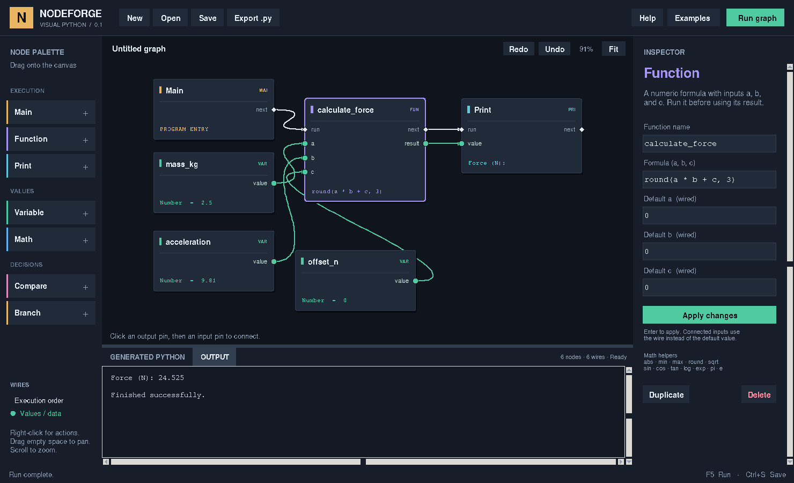

# PyDrop 0.1.0

A Python desktop prototype for building Python programs with connected nodes,
inspired by visual scripting editors and Cole's Main → function + variables sketch.

## Start

For the packaged Windows app, run `PyDrop-0.1.0-win-x64-setup.exe` and open
**PyDrop** from the Start Menu. The installer and complete portable application
folder run without a separate Python installation. Editable projects remain
`.drop.json` / `.nodeforge.json` files; keep them when sharing an executable.

See [BUILDING.md](BUILDING.md) for the pinned Windows build, dependency inventory,
installer, clean-Windows test procedure, and the separate **Build EXE** option
for packaging an exported graph. A Python build environment is needed to create
executables, while recipients can run them without Python.

To run the editor from source:

Extract the complete ZIP, then double-click **Start_NodeForge.bat** on Windows.
Alternatively, open a terminal in this folder and run:

```sh
python nodeforge.py
```

Use **Python 3.10 or newer with Tkinter**. Simulation and the core editor have no pip dependencies.
Hardware serial communication additionally needs `python -m pip install pyserial` in the Python environment that starts PyDrop.
On Windows, include Tcl/Tk when installing Python. On many Debian/Ubuntu or
Raspberry Pi OS installations, the distributor's `python3-tk` package supplies
Tkinter. On macOS, use a Python distribution that includes Tcl/Tk.
Run `python -m tkinter` to verify that a test window opens.



## First five minutes

1. Open the app. The force example is already loaded.
2. Click **Run graph** or press **F5**. Output is `Force (N): 24.525`.
3. Select **mass_kg**, change **Value** from `2.5` to `10`, and click **Apply changes**.
4. Run again. Output becomes `Force (N): 98.1`.
5. Choose **Save** to keep your editable graph or **Export .py** to produce
   a standalone Python program.

For Arduino projects, open **Examples > Arduino | Simulated sensor dashboard**.
Run it immediately without hardware, then choose Hardware, a port, and a matching
baud rate on Serial Connect to use a board. Connect, Send, Read Line, Parse Value,
and Disconnect are in the Arduino / Serial palette. See [the serial guide](SERIAL_GUIDE.md)
for wiring, timeouts, connection status, and the matching Arduino sketch.

The example computes `round(a * b + c, 3)` with mass `a = 2.5 kg`, acceleration
`b = 9.81 m/s²`, and an additional force `c = 0 N`. Units here are conventions in
the names and labels in this original lesson. For enforced dimensions, choose
the new **Engineering | Force with units** lesson described below.

## More examples in pydrop

Open **Examples** in the toolbar to load a lesson, then press **F5** to run it.
Editable copies are also in the `examples` folder.

| Example | Try changing | Initial output |
|---|---|---|
| Hello pydrop | The greeting variable's text | Hello from pydrop! |
| Rectangle area | Width or height | Rectangle area: 40.0 |
| Celsius to Fahrenheit | Celsius temperature | Fahrenheit: 77.0 |
| Right triangle | Either side length | Hypotenuse: 5.0 |
| Split a bill | Bill amount, tip percentage, or number of people | Each person pays: $24.0 |
| Pass or fail | Score; try 59, 60, and 72 | Passed! Score is at least 60. |
| Interactive calculator | Answer the two number questions | Sum: 5.0 when answering 2 and 3 |
| Temperature controller | Temperature and system_enabled | Fan ON (hot and enabled) |
| Limit power | Requested power and bounds | Clamped power: 100.0 |
| Dice roller | Seed, mode, or bounds | Dice roll: 6 with seed 42 |
| Experimental measurements | CSV columns, power calculation, axis labels | A measurement table, two plots, and experimental_results.csv |

The original Force calculation and Temperature switch lessons remain available.
For Split a bill, keep the number of people above zero. For Pass or fail, the
comparison sends scores of 60 or above down the True path; lower scores take
the False path. The original lessons use editable constants. Interactive
calculator uses the Input panel described below.

## How the graph works

| Pin | Meaning | Example |
|---|---|---|
| White diamond | Execution order | Main → Function → Print |
| Green circle | A value or calculated result | mass_kg → Function.a |

Variables supply values when needed. Math and Compare nodes compute their output
when an executing node needs it. A Function is an executed numeric formula: its
white input must be connected, and it must run before its result is consumed.
Print only runs when reached from Main through white wires.

Each input accepts one wire. Connecting a replacement removes the previous wire.
An execution output has one destination. A data output can supply many nodes.
Cycles and incompatible pin types are rejected. Input defaults are used whenever
there is no wire; a connected wire overrides its default.

## Nodes

| Node | Purpose | Properties |
|---|---|---|
| Main | One program entry point | None |
| Variable | A named constant | Name, Number/Text/Boolean, value |
| Function | Run a formula with three arguments | Name, formula, a/b/c defaults |
| Math | Calculate with two numbers | +, −, ×, /, //, %, **; a/b defaults |
| Compare | Produce a boolean | >, >=, <, <=, ==, !=; a/b defaults |
| Branch | Follow a True or False execution path | Default condition |
| Print | Write to Output | Prefix and default text |
| Input | Ask a question when execution reaches the node | Question; returns text |
| Convert | Convert a value | Target type (Number/Text/Boolean), default value |
| Text Join | Combine two values as text | First/second defaults and separator |
| Boolean Logic | AND, OR, NOT for actual True/False values | Operation; a/b defaults (NOT ignores b) |
| Clamp | Keep a number inside a range | Value, minimum, maximum defaults |
| Random | Generate once when execution reaches the node | Integer/Decimal, min/max defaults, optional integer seed |
| Assign | Capture a calculated value under a name when execution reaches it | Name and default text; connected value overrides default |
| Function Call | Execute a reusable graph defined in this project | Named input defaults; named return outputs; double-click to open |
| Function Inputs | Supply a function's named arguments inside its body | Interface chosen when creating the function |
| Return | Finish a function and return named values | One input per return value, with numeric defaults |
| Quantity | Attach a unit to a numeric magnitude | Default magnitude, unit; optional unitless value input |
| Unit Convert | Convert compatible quantities | Target unit; default magnitude and source unit when unwired |
| Force | F = mass × acceleration | Default mass (kg) and acceleration (m/s^2); result in N |
| Torque | Force × perpendicular lever arm | Default force (N) and distance (m); result in N*m |
| Ohm's Law | V = current × resistance | Default current (A) and resistance (ohm); result in V |
| Electrical Power | P = voltage × current | Default voltage (V) and current (A); result in W |
| Installed Python node | Run an explicitly installed library definition | Versioned name/category, typed named inputs and outputs; editable input defaults |
| CSV Input | Read a headered UTF-8 CSV; preserve text and expose two selected numeric columns | File, delimiter, x/y column names |
| Data Table | Inspect selected columns and optionally add calculated values as a new column | Columns, added column name; optional values wire |
| Line Plot | Draw numeric measurements as a connected line | X/Y columns, title, axis labels; optional x/y vector wires |
| Scatter Plot | Draw numeric measurements as points | X/Y columns, title, axis labels; optional x/y vector wires |
| CSV Output | Write the full selected table as CSV | Destination, columns, delimiter, existing-file behavior |

### CSV data, tables, and plots

Use the **DATA** palette group or search for a node by name. All five data
nodes execute through white `run` → `next` wires. Wire **Main → CSV Input**
before any node that consumes the imported data. Results are available only
after the producing node executes, including inside branches and functions.

On **CSV Input**, use **Browse…**, then **Read column names** to populate
the editable X/Y selectors. Header discovery runs in a background thread.
You can also type exact, case-sensitive names. Blank X selects the first
column; blank Y selects the second. The green `data` output carries every
column as cell text. Green `x` and `y` outputs supply finite numeric lists
from the selected columns; an unused numeric output does not force text
columns to become numbers.

Connect `data` to **Data Table**, **Line Plot**, **Scatter Plot**, or
**CSV Output**. Table and CSV Output **Columns** fields accept a CSV-style
comma-separated list in the desired order; blank includes every column.
For example, `time_s,voltage_V,current_A` selects three columns. Quote a
header containing a comma, such as `time_s,"Force, N"`. Plots use exact
X/Y column names and offer editable title, X axis label, and Y axis label.
Blank labels use the selected column names. A connected `x` or `y` vector
overrides that axis's column selection; with both connected, `data` is optional.
Line plots connect points in file order.

**Math** operations work element by element on numeric columns. One scalar
input is broadcast across the other column; two columns must have equal
lengths. **Function** and **Custom** formulas also accept numeric columns
and run once per measurement. Scalar calculations retain their existing
behavior. Connect a calculated column to **Data Table.values**, set **Added
column name**, and pass the resulting `data` onward. The added name must be
new, and there must be exactly one calculated value per original row.

After **Run**, Data Table and plot nodes open read-only windows owned by the
application. Tables scroll horizontally and vertically. Select a CSV Input,
Data Table, or plot node and click **Inspect last data** to reopen its latest
preview. Values and previews are cleared when the graph changes. Table
previews show the first **200 rows and 100 columns**, with long cells shortened
to 300 characters. Plots show up to **2,000 evenly sampled points**, including
the endpoints. The windows identify truncated or sampled previews. Calculations
and CSV writes use the full dataset. Column names outside a preview can still
be typed directly.

Imports, numeric calculations, and CSV writes run in a child process while
Tk keeps processing its event loop. CSV graphs have a **60-second execution
allowance** in the editor; time waiting for an Input answer is excluded. Full
imports remain in memory, so available RAM limits file size. Closing the editor
stops an active run.

CSV files must have unique, nonempty headers and use UTF-8 (a UTF-8 BOM is
accepted). Quoted commas, quotes, and multiline cells are supported. Set the
delimiter to one character, such as `,` or `;`, or enter `\t` for tabs.
Empty physical records are skipped. The application explains these errors
and selects the failing node:

- Missing/unreadable file: the message includes the path and how to choose it.
- Invalid numeric cell: the column and one-based data row identify the value.
  Blank cells, text, NaN, infinity, and magnitudes above `1e100` are rejected
  when used numerically. Text remains valid in unconverted table columns.
- Ragged CSV rows or unequal vector/column lengths: the message gives the
  conflicting counts. Rows and points are never silently dropped or truncated
  to make lengths agree.

### Experimental measurements example

Choose **Examples → Experimental measurements | CSV, power, tables and plots**
and press **F5**. The editable graph is
[`examples/experimental_measurements.nodeforge.json`](examples/experimental_measurements.nodeforge.json),
and its six measurement records are in
[`examples/experimental_measurements.csv`](examples/experimental_measurements.csv).

The CSV contains `time_s`, `voltage_V`, `current_A`, and `trial`. CSV Input
selects voltage and current for its numeric outputs. A Math multiplication
calculates **power_W = voltage_V × current_A** for every measurement. Data
Table adds `power_W`; Line Plot shows power versus time, and Scatter Plot
shows measured current versus voltage. Both plots include unit labels. The
last sample is 6 V × 0.50 A = **3 W**.

CSV Output writes all original columns plus `power_W` to
`experimental_results.csv`. This example explicitly uses **Overwrite**, so
rerunning replaces that generated results file. From the menu, its input
points to the bundled dataset. The saved example uses a relative input path,
so keep the sample CSV beside that graph when copying it.

### Dependencies and data export behavior

These features use Python's standard-library `csv`, `math`, and Tkinter.
**No pandas, NumPy, Matplotlib, or pip packages are required.** The editor
and exported table/plot windows require Python 3.10+ with Tcl/Tk and a desktop
display. CSV-only exported programs run without importing Tkinter.

**CSV Output** writes UTF-8 CSV with a header, normal CSV quoting, the chosen
delimiter, and every row in the selected table. Raw imported cell text is
preserved; derived numeric values use Python's normal floating-point text.
There is no index column or append mode. **Error if exists** is the default;
select **Overwrite** explicitly to replace a destination. Writes use a temporary
file in the destination folder and publish only after writing succeeds, so a
failed write preserves the existing file. The destination folder must already
exist. A filesystem that cannot publish an exclusive hard link reports a write
error in **Error if exists** mode.

**Save** stores the editable graph and file references. **Export .py** embeds
the CSV/calculation runtime and, where needed, the table/plot viewer code in
one standalone Python file. Run it with Python; it needs no PyDrop modules.
Exporting itself does not run the graph or write CSV output. Running the
export performs the configured CSV writes and opens its table/plot windows;
close all presentation windows to finish the program. Input CSV files remain
external and must be distributed with the program.

Relative input and output paths start at the saved graph's folder for editor
runs and `nodeforge.py project.drop.json --run`. Unsaved graphs use the
application folder. Exported `.py` files resolve relative paths beside that
script; running generated source with `python -c` uses the working directory.
Absolute paths remain absolute. To move an exported workflow, use relative
paths and copy its input CSV alongside the script. Reruns reread the source
file and apply the selected output overwrite policy.

### Engineering quantities and units

Use the **ENGINEERING** palette group or type a node name. Add a **Quantity**,
set its magnitude and unit in the inspector, then connect its green `result`
pin to Math, a formula, or an engineering input. These new nodes compute when
their results are needed; connect Main to Print to display the result.
Quantity's optional `value` input accepts a unitless number, including the
result of Input → Convert to Number. It attaches the chosen unit explicitly.

Units are case-sensitive. The unit dropdown also accepts typed compound units.

| Dimension | Available symbols |
|---|---|
| Unitless | `1` |
| Length | `m`, `mm`, `cm`, `km`, `in`, `ft` |
| Mass | `kg`, `g`, `lb` (mass) |
| Time | `s`, `ms`, `min`, `h` |
| Force | `N`, `kN`, `lbf` (force) |
| Voltage | `V`, `mV`, `kV` |
| Current | `A`, `mA` |
| Resistance | `ohm`, `kohm`, `Mohm` |
| Power | `W`, `mW`, `kW` |
| Acceleration / torque | `m/s^2`, `N*m`, `N*mm`, `lbf*ft` |

Products, quotients, parentheses, and integer unit powers from -8 to 8 are
supported, for example `kg*m/s^2`, `m^2`, and `ft/s`. Unit expressions contain
symbols, not numeric scale factors. Use a Quantity's magnitude for scaling.

**Unit Convert** preserves the physical quantity: `1 m` converts to `100 cm`.
Its source unit applies only to its unwired default, and source/target defaults
must be compatible. A connected value carries its own source unit.
Converting length to time is rejected with the affected node and expected versus
received dimensions. Changing a Quantity's unit is a new declaration, rather
than a conversion: use Unit Convert to preserve an existing quantity.

Math and formula arithmetic retain dimensions. Addition, subtraction, remainder,
comparisons, `min`, `max`, and Clamp require compatible dimensions; multiplication
and division combine them. Floor division requires matching dimensions and
returns a unitless quotient. `sqrt` changes dimensions by a half power;
`abs` and `round` preserve them (`round` uses the quantity's display unit).
`sin`, `cos`, `tan`, `log`, and `exp` require unitless arguments. Powers require
a unitless exponent; dimensional values allow exponents from -16 to 16.
Compare quantities before using their result as a Branch condition. Clamp
bounds must be quantities with the same dimension as its value.

Unitless numbers and the original nodes remain available. Plain `0` is unitless,
so adding it to a length fails; use `0 m` for a length offset. Engineering node
defaults are explicitly in the units shown on their input labels. Wiring a
unitless number into Force.mass fails: attach `kg` or another mass unit first.
Random produces unitless numbers; attach units afterward with Quantity.
Convert to Text and Text Join display units. Convert to Number cannot silently
discard physical units; Unit Convert retains units throughout.

Known dimensional mismatches are rejected when connecting wires, applying
properties, loading graphs, or compiling. A rejected replacement wire preserves
the previous wire. While wiring Math/formula nodes, missing inputs are treated
as unknown so a pair of quantity wires can be added one at a time; compilation
checks the actual defaults. Reusable function arguments/returns have no declared
unit signature, so dimensions that depend on calls are checked at runtime.
Runtime errors name the operation or engineering input and its expected and
received dimensions. Trace output and the value inspector retain unit labels.

New menu lessons also ship as editable files in `examples`:

| Lesson | Inputs | Output |
|---|---|---|
| Engineering / Force | 2500 g × 9.81 m/s^2 | `Force: 24.525 N` |
| Engineering / Torque | 100 N × 250 mm | `Torque: 25 N*m` |
| Engineering / Ohm's Law | 250 mA × 2 kohm | `Voltage: 500 V` |
| Engineering / Electrical Power | 12 V × 500 mA | `Power: 6 W` |

Torque assumes a perpendicular lever arm; electrical power is DC or instantaneous
power, without AC phase or power-factor modeling. The unit model covers length,
mass, time, current, and derived dimensions; temperature offsets and angle units
are outside its scope. Dimension checking cannot distinguish physical meanings
with identical dimensions, such as torque and energy.

**Dependencies and export:** no new packages or pip dependencies. The editor uses
`engineering_units.py` and `unit_validation.py` from this folder, using only the
Python standard library. Export embeds the same quantity implementation and
runtime checks directly into the generated `.py` file, including reusable
functions; exported files require neither PyDrop nor an external units package.

### Reusable function graphs

Choose **Functions > New function** above the canvas. Give it a Python name,
comma-separated input names, and comma-separated return names. A function can
have zero to eight inputs and one to eight return values. The name and interface
are chosen at creation. The new editor contains Main, Function Inputs, and Return.
Add normal nodes, wire the named argument outputs into calculations, and connect
the calculated values to Return. Connect Main through any actions to Return.
Every execution path must end at a Return; branches can use separate Return nodes.

Click **Apply function** (Ctrl+S), then **Back to project**. Apply updates the
project in memory; save the project afterward to keep it on disk. Closing an
edited function asks whether to apply or discard its draft. Applying a body is
one project undo step; the function editor also has its own undo/redo history.

Use **Functions > Add call: name**, or add **Function Call** from the palette.
Connect its white run/next pins into the execution path. Connect named green
inputs or edit their numeric defaults in the inspector. Each call has independent
defaults; connected inputs override them and can carry numbers, text, or booleans.
Named return outputs are available after that call executes. Calls share the
same function definition, so editing its body updates every call.

**Double-click a call node**, select **Open function graph** in its inspector,
or use **Functions > Open graph: name** to edit the body. F5 in the function editor
runs the complete project using the current body draft. Inspection values inside
the editor show the last invocation of that function. Functions can call other
functions; direct and indirect recursion are rejected. Local variables are scoped
to each invocation. Project variables are not implicitly visible inside functions;
pass values through named inputs.

Try **Examples > Reusable function | Two rectangles**, also saved as
`examples/reusable_rectangle.nodeforge.json`. Its shared `rectangle_metrics`
graph returns area and perimeter. The first call uses width 2 and height 3;
the second uses width 4 and height 5:

```text
First area: 6.0
First perimeter: 10.0
Second area: 20.0
Second perimeter: 18.0
```

Python export defines ordinary callable Python functions such as
`rectangle_metrics(width, height)`, returning tuples in named-pin order. Exports
run without pydrop. Function definitions and bodies are embedded in project files;
existing projects without a function library retain their original format and behavior.

### Logic, ranges, and random values

**Boolean Logic** accepts Boolean variables, Compare outputs, or Convert results
set to Boolean. It always returns True or False. AND requires both inputs to be
True; OR requires at least one; NOT flips a and does not evaluate b. AND and OR
evaluate both connected inputs. Text such as `"False"` needs Convert first; it
is not accepted directly as a Boolean. NOT keeps its b pin so changing operations
preserves wires, but that input is ignored until AND or OR is selected.

**Clamp** evaluates when needed and returns a number between min and max,
including the endpoints. Connected bounds override their defaults. An equal
minimum and maximum always returns that bound; reversed bounds produce an error.

**Random** has white execution pins. Connect Main to Random, and Random to the
next action before using its green result. Integer mode includes both endpoints
and requires whole-number bounds. Decimal mode accepts fractional bounds; floating
point rounding can include either endpoint. Bounds must be finite numbers and
min must not exceed max. All consumers share the one generated result in that run.

Leave Seed blank for a fresh draw each run (draws can repeat by chance). Supply an
integer seed of up to 48 digits for repeatable results with the same mode and
bounds. The dice example uses seed 42 to make its output easy to check; clear it
to roll normally.

### Interactive input and text

Choose **Examples > Interactive calculator**, then press **F5**. Enter the first
number in the Output panel and click **Send** or press **Enter**; repeat for the
second number. **Cancel** ends the run. Waiting for an answer does not consume
the GUI runner's five-second execution limit.

Input has white execution pins: connect Main to Input, then Input to the next
action. Its green result pin supplies text only after that Input has executed.
Use Convert set to Number before connecting an answer to Math or Function.
Invalid numeric text highlights the Convert node and explains what to change.
Number conversions must be finite and no larger than 1e100 in magnitude.
Boolean conversions accept text True/False (case insensitive); numeric and
boolean inputs use Python truthiness. Text conversion uses Python's `str`.
Text Join also converts connected values to text and inserts the chosen
separator between them. Convert and Text Join are evaluated when needed and
have no white execution pins.

Exported programs ask questions in the terminal using Python's `input()`.
Interactive `--run` also uses the terminal and has no execution timeout; press
Ctrl+C to interrupt. Noninteractive `--run` retains its five-second limit.

Variable and function names must be unique Python identifiers beginning with a
letter. Keywords, builtin names, and math helper names are reserved.

Function formulas use `a`, `b`, and `c`; arithmetic; comparisons; boolean logic;
conditional expressions; and `abs`, `min`, `max`, `round`, `sqrt`, `sin`, `cos`,
`tan`, `log`, `exp`, `pi`, and `e`. Trigonometric inputs use radians.
For example:

```python
a * b + c
round(a * b + c, 3)
sqrt(a * a + b * b)
a if a > b else b
```

`round(value, digits)` accepts a literal precision from 0 through 12.
`min` and `max` accept 2–8 arguments. Other helper arities match the inspector's
numeric-formula use: one argument, except `round` and `log`, which accept one or two.

Number inputs are finite floating-point values of magnitude at most `1e100`.
Math and Function outputs are checked against the same limit. Function inputs
must be numeric; Text is intended for Print and suitable comparisons. Function
boolean results are normalized to `1.0` or `0.0`; Compare produces actual booleans.
Branch uses Python truthiness, so zero, empty text, and False select its false path.

## Controls

| Action | Control |
|---|---|
| Add a node | Drag from palette; click a palette item; or right-click empty canvas |
| Search for a node | Space on the canvas, or click empty canvas and start typing; ↑ / ↓ choose, Enter adds, Esc cancels |
| Add typed Python | Click empty canvas, type a supported statement, and press Enter; or right-click and choose Type Python or search |
| Select nodes | Shift-drag empty space for an additive box; Shift/Ctrl-click toggles nodes; Ctrl+A selects all |
| Move nodes | Left-click and drag a card; dragging a selected card moves its selection |
| Connect pins | Click output then input, or drag between pins |
| Cancel a connection | Esc or click empty canvas |
| Edit properties | Select node, edit inspector, press Enter or Apply |
| Pan | Left-drag empty canvas; middle-drag or Alt+left-drag also works |
| Zoom | Mouse wheel, centered at pointer |
| Zoom controls | Floating − / + buttons; click the percentage to reset to 100% |
| Overview | Click or drag the minimap to center the view on that part of the graph |
| Fit | Fit button or F while canvas has focus |
| Delete | Delete key or right-click action; applies to the entire selection |
| Disconnect | Right-click a pin or wire |
| Copy / cut / paste | Ctrl+C / Ctrl+X / Ctrl+V; internal wires are included |
| Duplicate | Ctrl+D or inspector button; duplicates selected nodes and their internal wires |
| Group / ungroup | Ctrl+G / Ctrl+Shift+G; group label and inspector offer rename/collapse controls |
| Collapse / expand | Click a group's +/− button, double-click its label, or Ctrl+Shift+C |
| Align / distribute | Edit menu or multi-selection inspector; edges, centers, horizontal/vertical spacing |
| Automatic layout | Layout button / Ctrl+L for the graph; Ctrl+Shift+L for selection only |
| Shortcut reference | F1 or Edit → Keyboard shortcuts |
| Undo / redo | Ctrl+Z / Ctrl+Y, or toolbar buttons |
| New / open / save | Ctrl+N / Ctrl+O / Ctrl+S |
| Save under a new name | Save As or Ctrl+Shift+S |
| Run | F5 |
| Export | Ctrl+E |

Property edits apply on Enter, Apply, selection change, Run, Save, or Export.
Dragging nodes and editing graph structure can be undone. Save dialogs guard
against losing changes when replacing or closing a graph.

### Selecting, arranging, and grouping nodes

**Space** opens the searchable node picker at the last canvas pointer position,
or at the view center. It searches built-ins and installed Python library nodes.
Opening the picker does not change the graph; accepting a result is one undo step.
The permanent code-entry field and click-to-type node creation remain available.

Left-click and drag a node to move it. Left-drag empty canvas to pan. Hold Shift
while dragging empty canvas to box-select cards and retain the previous selection.
Shift/Ctrl-click toggles individual nodes;
clicking a selected card keeps the selection so it can be dragged as a unit.
Relative positions are preserved, and the entire drag is one undo step. Use
left-drag on empty canvas, middle-drag, or Alt+left-drag for panning. A click with only tiny pointer movement
still establishes a typing/insertion point. Esc cancels a box or pending drag.

A body drag cancels any unfinished wire and moves the node in the same gesture.
Moving a selected node preserves unapplied inspector text. Function calls and
group labels perform double-click actions on release only when the pointer has
not been dragged, so those actions do not interrupt movement.

Copy/paste and duplicate include selected nodes, their properties, and wires
whose two endpoints are selected. Outside connections are omitted. Local names
are made unique. Reusable function calls carry their required definitions;
conflicting same-name definitions are reported without overwriting anything.
Function-body pastes use the owning project's existing function library.
Installed Python nodes remain versioned references: clipboard operations do
not install or execute code. Main and Function Inputs are unique structural
nodes and are excluded by the editor's copy/duplicate commands; cut leaves them
in place. Repeated pastes are offset so copies do not stack at the same point.

Use **Edit → Align / distribute** or the multi-selection inspector to align
left/right/top/bottom edges or centers. Distribution uses equal edge-to-edge
gaps and retains the outermost nodes; select at least three nodes. These tools
move only the selection and record one undo step.

**Ctrl+G** creates a labeled group from the selection. Drag its label to move
all members, including when collapsed. A node belongs to one group at a time;
nested groups are not supported. Rename, collapse/expand, or ungroup through
the label's context menu or inspector. Collapsed groups show a compact proxy
with their existing external connections. Internal cards and internal wires
are hidden; their positions, values, and execution remain unchanged. Expand to
access additional internal pins. Ungroup removes the enclosure without deleting
members or wires. Delete on a selected group removes its member nodes; undo
restores them. Labels, membership, and collapse state are saved with the project
and copied when the entire group is copied.

The minimap shows group bounds, collapsed proxies, visible wires, and the current
viewport. Click or drag it to navigate. Panning, zooming, fitting, and selection
are view operations and do not move graph nodes or add undo entries.

**Automatic layout runs only on request.** It places execution paths from left
to right, keeps branch lanes ordered, considers data dependencies, packs
variable-height cards without overlap, and uses repeated crossing-reduction
passes to order nodes. Disconnected components are packed separately. Selection
layout keeps other nodes fixed and treats them as obstacles. This is a heuristic,
not a guarantee of a crossing-free drawing. Loading, saving, running, adding
nodes, grouping, and navigating never invoke layout or replace manual positions.
Layout changes positions only, leaves code and wiring unchanged, and is one
undo step. Undo restores the previous manual arrangement exactly.

Group creation, label changes, collapse/expand, ungrouping, paste/cut/duplicate,
deletion, alignment, and layout all participate in Ctrl+Z/Ctrl+Y history. Graph
shortcuts leave Entry, Text, Combobox, Spinbox, and picker text editing to their
native bindings; focus the graph to use graph editing shortcuts.

### Type Python to create nodes

Use the permanent **Type Python or a node name** field above the canvas, then
press **Enter** or click **Add**. Press **Tab** or **B** from the workspace to
focus this field; **Ctrl+Space** also works. While editing a text field, B types
normally and Tab moves to the next control. You can type
without first clicking the canvas: nodes are placed at the view center, or at
your last empty-canvas click. Close and reopen pydrop after updating its files
to load the new interface.

You can also click empty canvas and start typing to open the floating picker.
It previews the corresponding node; Enter adds it and Esc cancels. Incomplete
code opens the picker with an explanation and keeps your text for correction.

| Type | Creates |
|---|---|
| `speed = 10` | Number Variable named speed |
| `enabled = True` | Boolean Variable named enabled |
| `greeting = "Hello"` | Text Variable named greeting |
| `print("Hello")` | Print with its text already filled in |
| `print(speed * 2)` | Print and Math, connected to the existing speed Variable |
| `input("Your name? ")` | Input with its question filled in |
| `total = price * quantity` | Math plus a named Assign action, wired to price and quantity |
| `name = input("Your name? ")` | Input followed by Assign; later statements can reference name |
| `print(float("12.5") + 1)` | Connected Convert, Math, and Print nodes |
| `print(random.Random(42).randint(1, 6))` | Connected seeded Random and Print nodes |

Nested expressions create a connected group, arranged in dependency columns with
non-overlapping cards. The final node stays at the clicked position, and the view
fits the new group when needed. Internal actions connect in evaluation order.
Each insertion is one undo step and saves as ordinary editable nodes.

Use **Connect actions** to choose **Disconnected**, **After Main**, or
**After selected** before adding code or a node by name. A connected import is
inserted before the anchor's existing successor, preserving that downstream
execution path. Select an action with a `next` output for After selected; choose
Branch paths manually. Disconnected groups retain their internal wiring.

### Multi-line scripts

Click **Script…** above the canvas to open a multi-line editor. Enter adds a
newline; **Ctrl+Enter** or **Preview** shows the proposed group without changing
the graph. Choose the connection location, then click **Add group**. The default
sample demonstrates these assignments:

```python
price = 12.5
quantity = 3
total = price * quantity
name = input("Your name? ")
print("Hello " + name)
print(total)
```

The script dialog defaults to After selected when a suitable action is selected,
otherwise After Main. If the draft has no Main, a connected action import creates
one. Invalid source reports an error and leaves the graph unchanged. Editing
source or connection choices requires a fresh preview. Imports support up to
50 statements, 12,000 source characters, and the graph's 120-node limit.

Supported input includes constant and expression assignments; arithmetic; single comparisons;
Boolean AND/OR/NOT; print with zero or one argument; input with a constant text
prompt; float/str conversions; and random.randint/uniform, optionally through
random.Random(integer_seed). Named references resolve Variables, Function results,
and Assign results, including earlier definitions in the same script. Function
and Assign results need their normal execution wires. Constant assignments create
Variables; other assignments capture their calculated value in an Assign action.
The resulting graph uses pydrop's numeric and Boolean rules: numeric variables
and arithmetic use floating-point numbers, and Boolean Logic requires booleans.

Names must be unique: reassignment, imports, loops, arbitrary calls,
chained comparisons, and print keyword arguments are not supported. Incomplete
or unsupported code remains in the box with an explanation and leaves the graph
unchanged. This entry translates syntax into nodes without running the typed code.

### Inspect values after running

After F5 finishes, node footers show their last captured result. Select a node to
see its type and value under **LAST RUN VALUE** in the inspector. Print shows the
value it printed, Branch shows its condition, and execution-only nodes show that
they ran. Unreached nodes show Not evaluated. Text previews are shortened for
readability. Changing graph code/properties or starting a new run clears old
results; results are session-only and are not saved into graph files.

### Your own language: Drop

Drop is a starter custom language that translates into pydrop's existing node
graphs. Restart pydrop, click **Script…**, select **Drop** under Language, and
click **Load example**. Choose a connection location, then **Preview → Add group**
and press **F5**. Switching languages keeps your current source; Load example
explicitly replaces it with an example in the selected language.

```text
let price be 12.5
let quantity be 3
let total be price times quantity
ask "Your name? " into name
say "Hello " plus name
say total
```

Use one statement per line. `let name be expression` defines a value, `ask
"question" into name` reads text, and `say expression` prints it. Use `#` for
comments. Keywords are case insensitive; value names are case sensitive. Quoted
strings retain their contents, including words that also serve as operators.

| Purpose | Drop syntax |
|---|---|
| Arithmetic | plus, minus, times, divided by, modulo, power of |
| Comparisons | greater than, less than, equal to, not equal to |
| Inclusive comparisons | greater than or equal to, less than or equal to |
| Boolean logic | true, false, and, or, not |
| Grouping | `(expression)` |
| Numeric input | `ask "Amount? " into answer`, then `let amount be float(answer)` |
| Text plus numbers | `say "Total: " plus str(total)` |

Arithmetic uses normal precedence: times/division bind more tightly than plus
and minus. Drop uses the same numeric, Boolean, assignment, and size rules as
pydrop's Python frontend. Reassignment, loops, and conditional statement blocks
are not supported yet. Errors identify the source line and leave the graph intact.

Editable source examples are `examples/shopping.drop` and `examples/logic.drop`.
Their ready-to-run node graphs are also available under **Examples → Drop
language | Shopping and input** and **Examples → Drop language | Boolean
decisions**. The shopping lesson asks for your name; the logic lesson prints
True and False. Editable graph copies are saved as `drop_shopping.nodeforge.json`
and `drop_logic.nodeforge.json` in the examples folder.
They can also run or export from a terminal:

```sh
python nodeforge.py examples/shopping.drop --run
python nodeforge.py examples/logic.drop --export my_program.py
python nodeforge.py examples/shopping.drop
```

Opening a .drop file in the GUI creates an editable graph. Saving that graph
uses a separate graph filename and does not overwrite the source file.

To customize the language, edit `drop_language.py`:

- **LANGUAGE_NAME:** its name in the language selector.
- **KEYWORDS:** lowercase words for definitions, binding, questions, destination,
  and output. For example, change output from `say` to `show`.
- **WORD_OPERATORS:** token phrases mapped to arithmetic/comparison operators;
  longer phrases match first.
- **SAMPLE:** a program using your chosen syntax, shown by Load example.

Keep command words distinct and update the examples when changing them. Restart
pydrop after editing the definition. For new behavior beyond existing nodes,
extend the graph model/compiler and then add its grammar to this frontend.

### Create your own reusable node

Click **Create node** in the top toolbar. The form starts with an Add tax example:

1. Give the node a name and an optional short description.
2. Name one to three number inputs and give each a default number. Leave unused
   input names blank. For example: price = 100 and rate = 10.
3. Write a formula using those names, such as
   `round(price * (1 + rate / 100), 2)`.
4. Click **Test formula** to try the default numbers. This example returns 110.0.
5. Click **Create & add** to save the template and place a node in the workspace.

Your saved templates appear under **My Nodes** in the palette. Drag or click one,
or press Tab/B and search its name to add another instance. Names can contain
letters, numbers, spaces, and underscores; each saved template needs a unique
name. Input names begin with a letter and use letters, digits, or underscores
(16 characters max); they are case sensitive. Builtin names and run/next/result
are reserved input names.

These custom nodes perform numeric calculations using the same formula helpers
as Function nodes. They have white run/next pins and one green result pin.
Connect Main → your node → Print, and connect result → Print.value. The existing
Connect actions choice also applies when creating/adding a custom node.

Select an instance to edit its formula or default inputs in the inspector.
Those edits affect only that instance; the saved template keeps its original
defaults. Graph undo removes a placed instance but retains the reusable template.
Run values and errors work the same way as for built-in nodes.

The reusable library is stored in `custom_nodes.json` beside the app and reloads
on startup. Each placed instance embeds its complete definition in the graph,
so shared graphs and standalone Python exports do not require the creator's
library file. This first creator supports numeric formulas with up to three
inputs; action sequences and graph-defined node bodies are not supported yet.

Run executes generated Python in a separate process with a five-second time limit.
After completion, the graph highlights the execution path that actually ran.
This is a replay of the execution trace, not a debugger or live stepping mode.
Runtime errors, including division by zero and invalid numeric inputs, appear
in Output.

### Versioned Python node libraries

Open **Libraries…** in the toolbar. The existing **Create node** formula creator
remains available for simple numeric templates. Python libraries support full
function bodies, categories, and multiple typed outputs.

1. In **Author a library**, set the library ID/name/version and the node's
   definition ID/version, display name, category, and description.
2. Describe inputs and outputs in the JSON fields. Choose `Number`, `Text`,
   `Boolean`, `Quantity`, or `Any`. Inputs have string defaults. Quantity ports
   also declare a compatible `unit`, such as `m` or `N`. Use up to eight inputs
   and eight outputs; a node may have no inputs but needs at least one output.
3. Write a Python **function body**. Input names are its arguments. Return a
   dictionary whose keys exactly match the output names. The authoring form
   creates one definition per file; library files can contain up to 100 definitions.
4. **Save library file…** creates a reusable `.pydrop-lib.json` file. Saving
   neither installs nor executes it. Use **Browse library file…** to review
   metadata, dependencies, and every implementation in the file.
5. Click **Install executable Python** to explicitly enable the reviewed file.
   Installation copies the definitions into the local store and records their
   content fingerprint; installation itself does not execute their Python code.

**These are executable Python libraries.** Their implementations run with your
permissions when reached by a graph's white execution wire. They can import
packages, access files, and perform other Python operations. Review a library
before installing it. Browsing, editing, saving, scanning dependencies, opening
a project, and generating Python do not execute library implementations or
import their dependency modules. The normal runner timeout is not a Python
security sandbox.

Installed nodes appear under **PYTHON / category** in the palette. Search by
node name, category, description, library ID, or version in the existing node
picker. Palette tooltips, node cards, and the inspector identify executable
Python and show versions. Connect Main → node → Print, and connect the desired
named output to Print.value. Installed nodes run once when reached; their named
outputs become available afterward. Input defaults are editable per instance;
editing the implementation requires saving and explicitly installing a new version.

Try the bundled, **uninstalled** sample
[`examples/calculation-tools.pydrop-lib.json`](examples/calculation-tools.pydrop-lib.json).
It defines **Scale and describe**, with two Number inputs and Number/Text outputs.
After review and installation, its default `message` output is `Scaled: 6`.

Example file (IDs are stable identifiers; names and categories are display text):

```json
{
  "format": "pydrop-node-library",
  "schema_version": 1,
  "id": "calculation-tools",
  "name": "Calculation tools",
  "version": "1.0.0",
  "requirements": [],
  "nodes": [{
    "id": "scale",
    "version": "1.0.0",
    "name": "Scale a number",
    "category": "Calculations",
    "description": "Multiply a value by a factor.",
    "inputs": [
      {"name": "value", "type": "Number", "default": "3"},
      {"name": "factor", "type": "Number", "default": "2"}
    ],
    "outputs": [{"name": "result", "type": "Number"}],
    "implementation": "return {\"result\": value * factor}"
  }]
}
```

`Number` means a finite Python int/float, excluding bool, with magnitude at most
1e100. `Boolean` requires bool; `Text` requires str. `Quantity` inputs and outputs
retain dimensional checks and are converted to the port's declared display unit;
Python arithmetic on those arguments preserves units. A body can construct an
engineering quantity with `_Quantity(magnitude, "unit")` when it declares Quantity
ports. `Any` accepts values of any Python type (an unwired Any default is text).
Known incompatible wires are rejected without replacing the previous wire;
dynamic values, returned output types, and output dictionary keys are checked
at runtime, including in exported programs.

Declare third-party imports in library-level or node-level `requirements`:

```json
[{"module": "numpy", "package": "numpy", "version": "2.0.0"}]
```

`module` is an absolute import name. `package` is its optional distribution name,
which can differ from the import name; `version` is an optional **exact** installed
distribution version and requires `package`. Standard-library imports need no
package declaration. Imports written directly in the implementation are also
scanned without importing them. Dynamically imported dependencies must be
declared explicitly. Dependency scans cannot guarantee that a package's own
imports or platform-specific code will succeed. Dependencies must be installed
in the Python environment running PyDrop (and the environment running an export).
PyDrop does not download packages automatically or bundle adjacent Python modules.
Relative imports are unsupported; use installed packages with absolute imports.

Each library and definition uses an exact `major.minor.patch` version. Installed
versions coexist; existing projects are not upgraded silently. Changing a
definition requires increasing both its definition version and the library
version. Reinstalling different contents under the same library version is
rejected. The reviewed fingerprint is checked again at installation; a file
changed after preview needs another review. Installed file changes also block
compilation until the matching reviewed contents are restored.

Projects save the node's port schema, defaults, IDs, exact versions, and library
fingerprint. They do **not** embed executable implementations or grant installation
permission. Opening a project with missing libraries, definitions, wrong versions,
changed fingerprints, or missing Python dependencies reports the issue while
retaining editable nodes and wires. The inspector and **Installed and project
dependencies** tab show details. Run and export require the matching installed
definitions and dependencies. Copying an arbitrary library file beside a
project or into the store does not install it.

The local store is `installed_node_libraries` beside the app, with an explicit
`registry.json` and fingerprint-named library files. It is separate from the
legacy `custom_nodes.json` formula collection. Use `--library-store DIR` for an
alternate store. Standalone exports embed the approved implementations and typed
runtime wrappers and are marked **EXECUTABLE PYTHON**; they need no PyDrop library
store, but still require any third-party packages declared by the implementation.
No new dependency is required for PyDrop's library system itself.

## Files and command line

| File | Purpose |
|---|---|
| nodeforge.py | Tkinter editor and command-line entry point |
| graph_core.py | Graph model, validation, and Python generation |
| code_to_nodes.py | Short-script translation, named assignments, insertion, and group layout |
| drop_language.py | Starter custom language: keywords, word operators, parser, and sample |
| custom_nodes.py | Validation and persistence for reusable numeric node templates |
| node_libraries.py | Versioned Python library files, dependency inspection, and explicit installation catalog |
| library_ui.py | Library authoring, review, installation, and dependency UI |
| library_runtime.py | Typed input/output checks embedded in Python library exports |
| editor_tools.py | Multi-selection, clipboard, arrangement, shortcuts, and group presentation |
| graph_editing.py | Atomic clipboard fragments, alignment, and group operations |
| graph_layout.py | Explicit execution-aware automatic layout and crossing reduction |
| examples/force.nodeforge.json | Main/function/three-variable example |
| examples/temperature.nodeforge.json | Compare + Branch example |
| examples/force_export.py | Standalone generated example |
| tests/test_core.py | Compiler and persistence checks |
| tests/test_gui.py | Desktop interaction checks; requires a graphical display |

```sh
python nodeforge.py examples/temperature.nodeforge.json
python nodeforge.py examples/force.nodeforge.json --run
python nodeforge.py examples/force.nodeforge.json --export my_program.py
python my_program.py
python nodeforge.py --inspect-library examples/calculation-tools.pydrop-lib.json
python nodeforge.py --install-library examples/calculation-tools.pydrop-lib.json
python nodeforge.py my_project.drop.json --library-store installed_node_libraries --run
python -m unittest discover -s tests -v
```

Save creates `.drop.json` projects; Open accepts both `.drop.json` and legacy
`.nodeforge.json` projects. Both store nodes, positions, properties, and wires.
Use **Save As** (Ctrl+Shift+S) to choose a new name or folder. After saving,
subsequent saves update that file; the original stays available. Canceling or
a failed save keeps the current project path and its unsaved-change status.
Built-in and formula-node exports need only the standard library, not NodeForge.
Python library exports also need their declared third-party packages. Edits made to an
export do not update the visual graph. Camera position and zoom are not stored.

## Scope and extension points

This is a working first prototype, not a complete replacement for Unreal's
Blueprint system. It creates new code from graphs. It does not parse existing
Python files into graphs. There are no loops, mutable variables, classes,
arbitrary imports in the formula/script translator, breakpoints, or built-in
hardware interfaces yet. Explicitly installed Python library nodes support
multiline function bodies and imports. The maximum is 120 nodes per graph and
32 reusable functions per project.
Execution branches cannot merge into one input; duplicate downstream nodes if
both paths need the same action.

The formula allowlist limits the supported language; the runner is not a
general-purpose security sandbox for arbitrary Python. Exported files are normal
Python source and run with the permissions of the user who executes them.

Next useful additions:

1. Structured For/While blocks and mutable assignment nodes, with defined scope rules.
2. More typed engineering and domain-specific node libraries.
3. Step-through execution and breakpoints.
4. Expand statement-to-node translation to supported complete scripts.

To add a node kind, update `KINDS`, `ports`, defaults, and validation in
`graph_core.py`; add compiler behavior; then add its inspector fields in
`nodeforge.py`. Keep the graph model separate from the interface so another
frontend or a future Wizard backend can reuse it.

## Reference documentation

- [Python's Tkinter documentation](https://docs.python.org/3/library/tkinter.html)
- [Python's AST documentation](https://docs.python.org/3/library/ast.html)

Implementation and generated code are included so you can modify the project.
